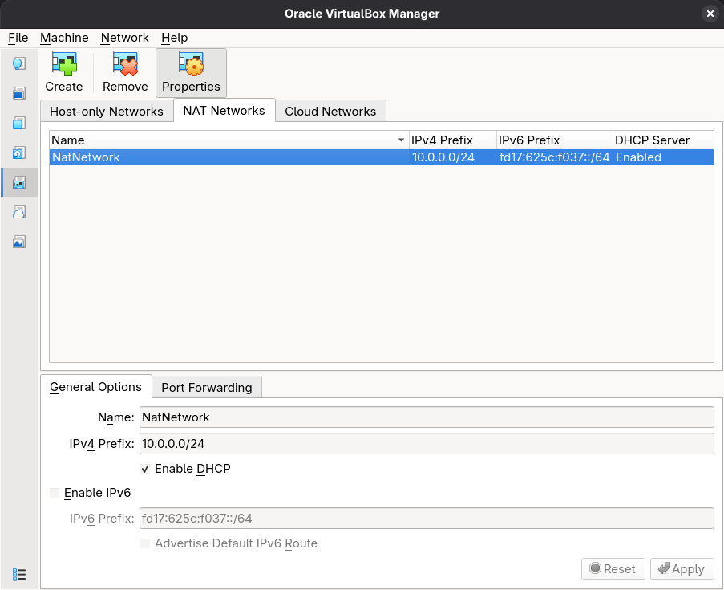
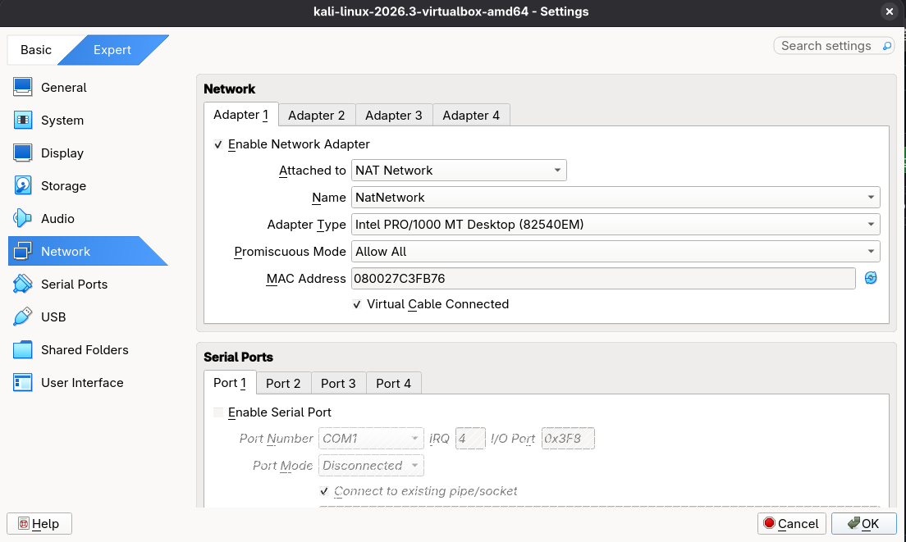
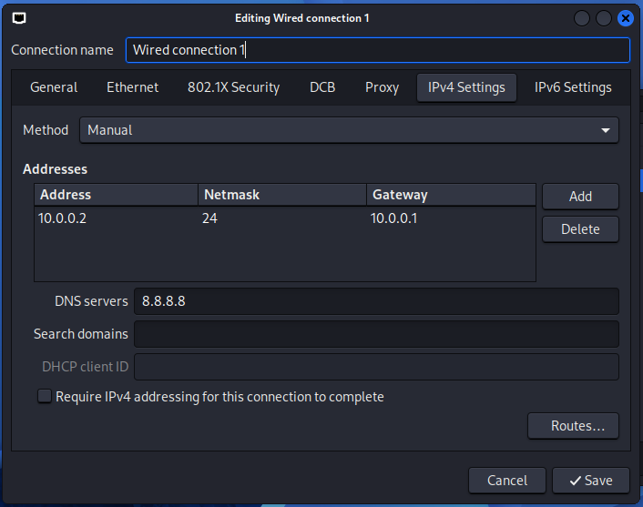

# Cybersecurity Lab Environment Setup
Building an isolated virtual lab for ethical hacking practice.

---

## Project Overview
This project focuses on setting up a virtual cybersecurity and penetration-testing laboratory using VirtualBox and Kali Linux.
The purpose of the lab is to create a controlled environment where cybersecurity tools, network scanning, reconnaissance, vulnerability assessment, and other security-testing activities can be performed safely and repeatedly.  
The lab is configured on a private virtual network so that additional machines can be added later and used as targets for authorized security testing.

---

## Objectives
* Install and configure VirtualBox.
* Install/import Kali Linux as a virtual machine.
* Create a private NAT Network for the cybersecurity lab.
* Configure network connectivity for Kali Linux.
* Assign a consistent IP address to the Kali VM (`10.0.0.2/24`).
* Verify network connectivity and DNS resolution.
* Take a clean VM snapshot for reliable recovery.
* Document the complete setup process.
* Prepare the environment for future cybersecurity projects.

---

## Purpose of the Lab
The lab provides an isolated and controlled environment for cybersecurity learning and authorized security testing. It can be used for:
* Network reconnaissance & port scanning
* Vulnerability assessment & packet analysis
* Web security testing & exploitation practice
* Security-tool experimentation

> **Important:** This laboratory must only be used for systems that you own or have explicit permission to test. Do not use the lab or its tools to attack unauthorized systems.

---

## Lab Configuration

| Component | Configuration |
| :--- | :--- |
| **Host OS** | Fedora Linux |
| **Host RAM** | 8 GB |
| **Processor** | Intel Core i5 |
| **Hypervisor** | VirtualBox 7.2 |
| **Security OS** | Kali Linux 2026.2 |
| **Kali RAM** | 2048 MB |
| **Virtual Network** | NAT Network |
| **Network Address** | `10.0.0.0/24` |
| **Kali IP Address** | `10.0.0.2/24` |
| **Default Gateway** | `10.0.0.1` |
| **DNS Server** | `8.8.8.8` |
| **Future VM Range** | `10.0.0.3 – 10.0.0.99` |

---

## Lab Setup Procedure

1. **Step 1: Install 7-Zip**  
   Installed 7-Zip to extract the Kali Linux virtual machine package (`.7z` archive).
2. **Step 2: Install VirtualBox**  
   Installed Oracle VirtualBox as the base hypervisor.
3. **Step 3: Create the NAT Network**  
   Configured a dedicated NAT Network (`10.0.0.0/24`) with DHCP enabled to allow future VMs to communicate locally and externally.
  

5. **Step 4: Import Kali Linux**  
   Imported Kali Linux into VirtualBox, assigned 2048 MB RAM, linked Adapter 1 to the `NATNetwork`, and set up a shared folder with the host machine.
   

7. **Step 5: Configure Kali Network**  
   Assigned a static IPv4 address (`10.0.0.2`), subnet mask (`255.255.255.0`), gateway (`10.0.0.1`), and DNS (`8.8.8.8`).
  

9. **Step 6: Create a Clean VM Snapshot**  
   Took a base snapshot named `Clean Kali - Network Setup` for easy restoration in case of misconfigurations.

---

## Lab Verification

| Test | Command | Expected Result |
| :--- | :--- | :--- |
| **Check IP Address** | `ip a` | Correct Kali IP (`10.0.0.2`) displayed |
| **Test Gateway** | `ping 10.0.0.1` | Successful replies |
| **Test Internet** | `ping 8.8.8.8` | Successful replies |

---

## What I Learned
1. **NAT vs. NAT Network:** Understood how a NAT Network allows peer-to-peer VM communication alongside outbound internet access.
2. **VM Networking:** Learned how VirtualBox network adapters bridge virtual environments.
3. **Static IP Configuration:** Mastered assigning static IPv4 addresses, subnets, and gateways via NetworkManager.
4. **VM Snapshots:** Realized the importance of baseline snapshots before executing experimental procedures.
5. **Documentation:** Learned professional technical writing and lab logging standards.

---

## Tools & Resources
* [VirtualBox](https://virtualbox.org/wiki/Downloads)
* [Kali Linux](https://kali.org/get-kali)
